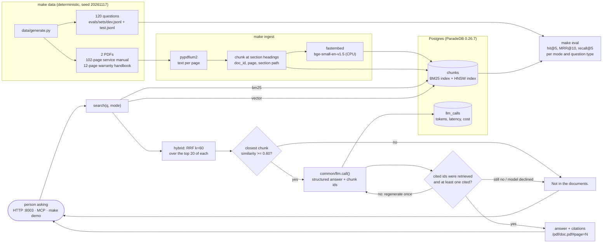

# Hybrid RAG Knowledge Assistant with Citations and Evals

Field technicians and support agents need exact, checkable answers from long manuals and policy handbooks (the torque for part HX-4471-B, the return window in §4.2.1), but keyword search misses questions asked in other words, vector search misses exact identifiers, and a chatbot that guesses or cites the wrong page is worse than none. This assistant combines BM25 and vector search, answers only with chunk citations that code verifies, replies "Not in the documents." when the documents don't cover a question, and measures every retrieval mode per question type.

Everything runs locally: Postgres (ParadeDB: pg_search for BM25, pgvector for vectors) in Docker, and the app with [uv](https://docs.astral.sh/uv/) on the host. The data is synthetic and generated by committed scripts, so every number below can be reproduced.

## Architecture



The person reading the answer is the human step: every citation links to the PDF page, so a claim can be checked in one click.

## Quick start

You need Docker and uv. Postgres listens on `localhost:5435`, the app on `localhost:8003`.

```bash
make up       # Postgres (ParadeDB) in Docker; also creates .env from .env.example
make data     # generate the PDFs and the 120-question eval set (identical on every run)
make ingest   # extract, chunk, embed, index (first run downloads the ~67 MB embedding model)
make test     # 154 tests; the model API is always faked, so no key and no cost
make eval     # retrieval eval on dev and test -> evals/results-retrieval-{dev,test}.md
make demo     # sample questions in all three modes; cited answers too if a key is set
make mcp      # MCP server over stdio, exposing `search`
make run      # HTTP API on http://localhost:8003 (docs at /docs)
```

`make test`, `make eval` and `make demo` run `make data` and `make ingest` first. Ingest skips documents whose SHA-256 hasn't changed, so repeat runs are fast.

**API:** `GET /search?q=...&mode=hybrid&k=5` returns ranked chunks. `POST /ask {"question": "..."}` returns a cited answer or "Not in the documents.". Citations link to `/pdf/<doc>.pdf#page=N`.

**Model answers** (`/ask`, `make eval-answers`, the answer part of `make demo`) need `ANTHROPIC_API_KEY` in `.env`, or an `ant auth login` profile. Everything else works without one.

**MCP client** (Claude Code example, untested with a real client; `tests/test_mcp.py` drives the same stdio server with the `mcp` SDK's client):

```bash
claude mcp add kb-search -- uv run --directory /abs/path/to/hybrid-rag-assistant \
  --env-file /abs/path/to/hybrid-rag-assistant/.env python -m app.mcp_server
```

## Data

- **Corpus:** `data/generate.py` writes a 102-page parts and service manual for a fictional "Halvard RS-Series" compressor (40 components, 280 catalog parts, 110 error codes) and a 12-page returns and warranty handbook (§-numbered clauses). Both are rendered to PDF with fpdf2, so ingestion has to parse real PDFs.
- **Planted facts:** part numbers (`HX-2238-X`), error codes (`E-4127`), clause numbers (`§4.2.3`), torque values, prices, replacement intervals and policy limits.
- **Questions:** 120 from templates: 40 exact-identifier, 40 paraphrased (other names for parts, plain-language policy questions), 20 that need two chunks (error code -> part -> catalog value; part -> warranty class -> handbook clause) and 20 unanswerable (made-up identifiers, topics the documents never cover). Split 40 dev / 80 test, every type in both.
- **Labels:** generated, not hand-written. Each fact has a "needle" string that occurs exactly once in the corpus. After ingestion the eval finds the chunk containing each needle and uses its id as gold, so labels survive changes to chunking. A test checks that every needle lands in exactly one chunk and that this chunk contains the expected answer. A formal hand-check of a sample has not been done yet.
- **Reproducible:** `make data` run twice produced identical SHA-256 checksums for both PDFs and both JSONL files (checked 2026-11-17). The PDFs are git-ignored; the JSONL sets are committed.

## Retrieval eval

Measured 2026-11-17 by `python -m evals.run --split dev` and `--split test` (`make eval`). Full output, including the relevance-gate table: [dev](evals/results-retrieval-dev.md), [test](evals/results-retrieval-test.md).

- **Modes:** bm25 = pg_search keyword match; vector = bge-small-en-v1.5 cosine (**the baseline**); hybrid = both fused with RRF.
- **Metrics:** hit@5 = share of questions with a gold chunk in the top 5. MRR@10 = mean 1/rank of the first gold chunk (0 if not in the top 10). recall@5 = share of all gold chunks in the top 5, which differs from hit@5 only for two-chunk questions.
- **Size:** 33 answerable dev and 67 answerable test questions. Unanswerable questions have no gold chunk, so they are scored in the answer eval, not here.
- **Process:** retrieval settings were tuned on dev only; the test split was run once, after tuning stopped.

### Test split (report these)

| Question type | n | hit@5 bm25 | hit@5 vector | hit@5 hybrid | MRR@10 bm25 | MRR@10 vector | MRR@10 hybrid |
|---|---|---|---|---|---|---|---|
| exact_id | 27 | 1.000 | 0.444 | 1.000 | 0.889 | 0.292 | 0.818 |
| paraphrased | 27 | 0.148 | 0.519 | 0.407 | 0.115 | 0.405 | 0.237 |
| multi_chunk | 13 | 1.000 | 0.692 | 1.000 | 0.910 | 0.391 | 0.685 |
| all answerable | 67 | 0.657 | 0.522 | 0.761 | 0.581 | 0.357 | 0.558 |

recall@5 (test), bm25 / vector / hybrid: multi_chunk 0.500 / 0.346 / 0.500; all answerable 0.560 / 0.455 / 0.664.

### Dev split (used for tuning)

| Question type | n | hit@5 bm25 | hit@5 vector | hit@5 hybrid | MRR@10 bm25 | MRR@10 vector | MRR@10 hybrid |
|---|---|---|---|---|---|---|---|
| exact_id | 13 | 1.000 | 0.385 | 0.923 | 0.923 | 0.378 | 0.857 |
| paraphrased | 13 | 0.308 | 0.692 | 0.692 | 0.195 | 0.564 | 0.531 |
| multi_chunk | 7 | 1.000 | 0.714 | 1.000 | 0.929 | 0.385 | 0.814 |
| all answerable | 33 | 0.727 | 0.576 | 0.848 | 0.637 | 0.453 | 0.719 |

### What the numbers say

- **Hybrid has the best hit@5 overall on test** (0.761, against 0.522 for the vector baseline and 0.657 for bm25). It matches bm25 on exact identifiers (1.000) and on two-chunk questions (1.000).
- **bm25 beats hybrid on test MRR@10 overall: 0.581 vs 0.558.** Hybrid finds the gold chunk more often, but on identifier questions it ranks it lower than bm25 does (0.818 vs 0.889), because the vector list pulls in look-alike chunks.
- **Vector beats hybrid on paraphrased questions: test hit@5 0.519 vs 0.407, MRR@10 0.405 vs 0.237.** When the user's words don't appear in the documents, bm25 contributes noise, and RRF gives that noise the same vote as the vector list. On dev the two tied on hit@5 (0.692), which is why this only showed up on test.
- **Exact identifiers are where vector search fails:** test hit@5 0.444. `HX-4471-B` and `HX-4417-B` look nearly identical to an embedding model.
- **Two-chunk questions are half solved:** hybrid finds at least one gold chunk every time (hit@5 1.000) but both chunks only half the time (recall@5 0.500). A single retrieval pass can't follow "error code -> part number -> catalog entry".

### Search latency

Milliseconds per query, including embedding the query on CPU (top 10), from the same runs:

| Mode | dev p50 | dev p95 | test p50 | test p95 |
|---|---|---|---|---|
| bm25 | 28 | 43 | 28 | 38 |
| vector | 49 | 61 | 53 | 62 |
| hybrid | 60 | 70 | 61 | 67 |

These were measured on a shared machine with a **load average of about 15** (`uptime` showed 15.84 on 8 cores shortly before the run), so treat them as an upper bound for this setup.

## Answer eval

`make eval-answers SPLIT=dev` (then `SPLIT=test`) runs the full pipeline on each question and grades it in code:

- **answer correct:** the answer contains the planted value as a whole token (`46` matches "46 Nm", not "146" or "46.5");
- **citation precision:** cited chunks that are gold chunks / all cited chunks;
- **decline accuracy:** the share of unanswerable questions answered "Not in the documents.";
- **latency and cost:** p50/p95 per question, and cost per question measured from the `llm_calls` table.

The harness is tested end to end against a fake Messages API (`tests/test_evals.py`).

| Metric | Haiku 5.5 (`small`) | Opus 5.5 (`large`) |
|---|---|---|
| Answer correct, per type | Not run yet — needs ANTHROPIC_API_KEY | Not run yet — needs ANTHROPIC_API_KEY |
| Citation precision | Not run yet — needs ANTHROPIC_API_KEY | Not run yet — needs ANTHROPIC_API_KEY |
| Decline accuracy (unanswerable) | Not run yet — needs ANTHROPIC_API_KEY | Not run yet — needs ANTHROPIC_API_KEY |
| p50 / p95 latency per question | Not run yet — needs ANTHROPIC_API_KEY | Not run yet — needs ANTHROPIC_API_KEY |
| Measured cost per question | Not run yet — needs ANTHROPIC_API_KEY | Not run yet — needs ANTHROPIC_API_KEY |

**Cost estimate for one run on dev + test (not a measurement).** From `python -m evals.run --split dev --answers --estimate` and `--split test`, 2026-11-17:

- 119 model calls (1 test question is declined by the relevance gate first) and 71,510 input tokens. Tokens are counted from the real retrieved prompts at 4 characters per token.
- Output is assumed to be 300 tokens per call, thinking included. This is not measured.
- Prices are those in `common/llm.py`, cached 2026-11-03: Haiku 5.5 $0.10/$0.50 and Opus 5.5 $4/$20 per million input/output tokens.

| Model | dev (40 calls) | test (79 calls) | total |
|---|---|---|---|
| `claude-haiku-5-5` | $0.0084 | $0.0166 | ~$0.03 |
| `claude-opus-5-5` | $0.3354 | $0.6647 | ~$1.00 |

The estimate leaves out structured-output schema overhead, regenerations and schema retries. Output tokens dominate the cost: at 1,000 output tokens per call the totals would be about $0.07 (Haiku) and $2.67 (Opus).

## Failure modes

| Failure | How it's handled | Tested by |
|---|---|---|
| Question the documents don't cover | Off-topic: the relevance gate declines before any model call. On-topic: the model is told to set `declined`, and the reply is "Not in the documents." | `test_answer.py`, `test_search.py` (gate); real-model behaviour not run |
| Nothing retrieved (empty query) | `search` returns no chunks, so the answer step declines without a model call | `test_answer.py` |
| Hallucinated or missing citation | Code checks that at least one chunk is cited and every cited id was retrieved; if not, regenerate once, then decline | `test_answer.py` |
| Instructions planted inside a document | Chunks are wrapped in `<chunk>` tags and the system prompt says they are data, not instructions | Not tested against a real model |
| User text that would break the BM25 query | The `\|\|\|` operator runs the text through the tokenizer, never a query parser (`@@@` raises "could not parse query string" on `what is "HX-4471`) | 28 hostile strings × 3 modes in `test_search.py` |
| A document changes, is renamed or is deleted | SHA-256 per document: a changed document is deleted (chunks cascade) and re-indexed; a vanished PDF loses its chunks | `test_search.py::test_reingest_skips_unchanged_documents` (skip path) |
| A chunking change silently breaks the labels | Gold ids are re-resolved from needles on every run; a needle in zero or several chunks raises | `test_score.py`, `test_ingest.py` |
| Model refuses, hits max_tokens, or returns invalid JSON | `common/llm.call()` retries schema failures, then raises `LLMError`; `/ask` returns 502 | `test_llm.py`, `test_api.py` |
| No model credentials | `/ask` returns 503 with the fix; `make demo` shows retrieval only | `test_api.py` |
| Every model attempt costs money | One `llm_calls` row per API attempt; cost is NULL when it can't be priced | `test_llm.py`, `test_evals.py` |

## What I'd do next

- **Run the answer eval:** dev on Haiku 5.5 first (about $0.01 by the estimate above), then test once. Hand-check 30 answers against their citations to confirm the code grader.
- **Fix hybrid on paraphrases (dev only):** try a weighted RRF that trusts the vector list more when bm25 matches only common words, or a small cross-encoder reranker over the top 20. Accept it only if paraphrased MRR rises without losing exact-identifier hits.
- **Two-step retrieval for two-chunk questions:** pull identifiers (part numbers, warranty classes) out of the first chunk and search again. recall@5 on two-chunk questions is 0.500 today.

## Design decisions

These are deviations from the build guide or choices that change results. Each one gives its reason.

- **pypdfium2, not Docling.** Docling's markdown export drops page numbers. pypdfium2 extracts text page by page, so every chunk's page is exact. It is also a single pip wheel with no system libraries.
- **Chunk = one section's text on one page.** Pages are cut at numbered ALL-CAPS headings, and each chunk keeps its heading path (`6 AIR END > 6.2 INLET VALVE > 6.2.3 INSTALLATION`). A chunk never crosses a page, so a citation always points to one page. This produced 612 manual chunks (median 47 words, max 128) and 45 handbook chunks (median 32, max 44). The heading path is embedded together with the chunk text. Chunk size was not tuned separately; it follows the document structure.
- **fastembed with BAAI/bge-small-en-v1.5 (384 dims) instead of an embedding API.** It runs locally on CPU through ONNX: no API key, no torch, no per-query cost. A larger hosted model would probably do better on paraphrases; that is not measured.
- **BM25 through pg_search's `|||` operator ("match any term").** It tokenizes user text instead of parsing it, so quotes, colons, `AND`/`OR` and `§` can never cause a syntax error. The `@@@` query-string operator does fail on such input, which was tested here.
- **BM25 tokenizer: `unicode_words` with English stemming and stopwords.** The default tokenizer splits `§4.2.1` into `4`, `2`, `1`, so it can't tell §4.2.1 from §2.1.4; `unicode_words` keeps `4.2.1` whole. You can check this with `SELECT '§4.2.1 HX-4471-B'::pdb.unicode_words::text[];`. Stemming lets "returned" match "return". In 0.26, `key_field` is deprecated and does nothing (Postgres prints a warning), so the index leaves it out.
- **`mutable_segment_rows = 0` on the BM25 index, and one `COPY` per document.** With the defaults, rows sat in pg_search's "mutable segment" and each keyword query took about 95–130 ms on 657 rows. With this setting and a single bulk load, a query took about 2–3 ms. Both were measured with psql `\timing` and a psycopg loop on this machine, under load.
- **RRF with k = 60, and 20 candidates per retriever, tuned on dev.** With 40 candidates, chunks that are mediocre in both lists outrank a chunk that one retriever puts first: dev hit@5 0.727 (40 candidates) vs 0.848 (20). Five, 10 and 20 candidates tie on dev hit@5 (0.848). 20 was chosen because it had the best paraphrased hit@5 (0.692) and close to the best MRR@10 overall (0.719 vs 0.727 for 5). See [evals/results-tuning-dev.md](evals/results-tuning-dev.md) (`make tune`).
- **The BGE query prefix was tried and rejected.** The model card's "Represent this sentence for searching relevant passages: " prefix raised vector-only dev hit@5 from 0.576 to 0.636. It lowered hybrid MRR@10 at 20 candidates from 0.719 to 0.680, and hybrid is the product, so it is off. The vector baseline above is therefore the plain model without the prefix.
- **Relevance gate at cosine similarity 0.60.** Off-topic probes scored 0.404 ("What is the capital of France?") to 0.566 ("How do I bake sourdough bread?"). The lowest answerable dev question scored 0.659. The gate only stops clearly off-topic questions: it declined 0 of 7 dev and 1 of 13 test unanswerable questions. On-topic questions the documents don't cover are left to the model's `declined` flag.
- **Deterministic grading, no LLM judge.** The guide suggests an LLM judge plus a hand-check of 30 of its judgments. Here the facts are planted, so code can grade exactly: the answer must contain the planted value, and the cited chunks are compared with the gold ids from needle lookup. This costs nothing, has no judge to validate, and is fully reproducible.
- **Regeneration doesn't tell the model what was wrong.** This follows the template's rule that business checks are never fed back to the model, which would bend its answer until it passes. The second attempt is a fresh sample of the same prompt.
- **The answer step defaults to the small tier (Haiku 5.5).** Looking up a planted fact in five short chunks shouldn't need frontier reasoning. `--tier large` switches the eval to Opus 5.5 for comparison.
- **`recall@5` added** next to the guide's hit@5 and MRR@10, because hit@5 alone counts a two-chunk question as solved when only one chunk was found.
- **`make test` runs `make data` and `make ingest` first,** so `make up && make test` works on a fresh clone with nothing skipped. Pure unit tests also run without a database (`uv run pytest tests/test_score.py`).
- **Host-run app, Docker only for Postgres.** The Dockerfile and the compose `app` service are kept from the template, with the app published on host port 8003. They were not rebuilt here because this machine's containers have no DNS.

## Limitations

- **Synthetic, templated text.** The corpus is repetitive and has no tables or figures. Real manuals are messier, and these numbers say nothing about them.
- **Heading detection fits this generator.** It relies on numbered ALL-CAPS heading lines. Real PDFs would need font-size or layout cues.
- **Small eval.** On test, one question moves a per-type number by 0.037 (27 questions) or 0.077 (13 questions). Dev decisions rest on 33 questions.
- **Labels are generated.** Their integrity is checked by code, but no sample has been hand-checked yet.
- **The answer step is unmeasured with a real model.** Correctness, citation precision, decline accuracy, latency and cost all wait on a key.
- **The grader can be fooled** by an answer that lists several numbers, or that writes a number in words ("twenty-one days").
- **Retrieval is single-pass,** so two-chunk questions often miss their second chunk.
- **Operations are portfolio-scale.** There is one database connection per search, re-indexing works per document rather than per page, and the embedding model downloads on first use (ingest fails without network).
- **pg_search is AGPL-3.0.** That's fine for a public portfolio, but it matters before selling this to a client.
- **The app image has not been built yet.** The GitHub Actions workflow passes on GitHub (ruff, 154 tests, retrieval eval smoke run), but the app container hasn't been built, and the MCP server hasn't been used from Claude Code or Claude Desktop (only from the `mcp` SDK client in tests).

## Repository map

| Path | What it is |
|---|---|
| `data/content.py`, `data/generate.py` | Corpus vocabulary; deterministic PDF and question generator |
| `db/init/20_app_schema.sql`, `30_chunks.sql` | `llm_calls`; `documents` and `chunks` with the BM25 and HNSW indexes |
| `app/ingest.py` | PDF -> pages -> chunks -> embeddings -> Postgres, skipping unchanged documents |
| `app/embeddings.py` | fastembed wrapper (local CPU embeddings) |
| `app/search.py` | `search(q, mode)`: bm25, vector, hybrid (RRF) |
| `app/answer.py` | Relevance gate, cited answer through `llm.call()`, citation post-check |
| `app/main.py`, `app/mcp_server.py`, `app/demo.py` | HTTP API (:8003), MCP `search` tool, terminal demo |
| `common/llm.py` | The only place a model is called; one `llm_calls` row per attempt |
| `evals/score.py`, `evals/run.py`, `evals/tune.py` | Metrics and grading, eval harness, dev-only tuning |
| `tests/` | 154 tests; model calls go to a fake API (real SDK, mocked HTTP) |

## Licence

MIT (see `LICENSE`). pg_search, used through the ParadeDB image, is AGPL-3.0.
